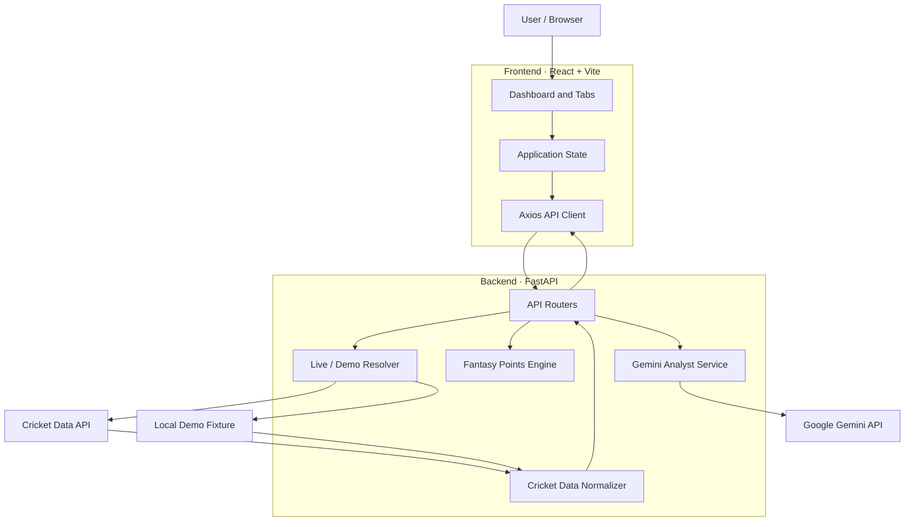
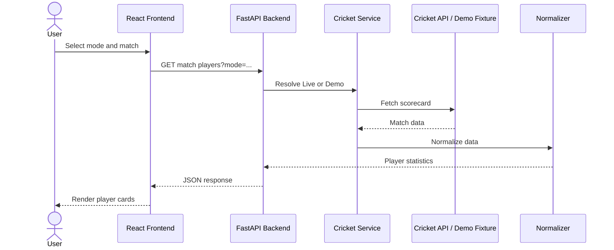
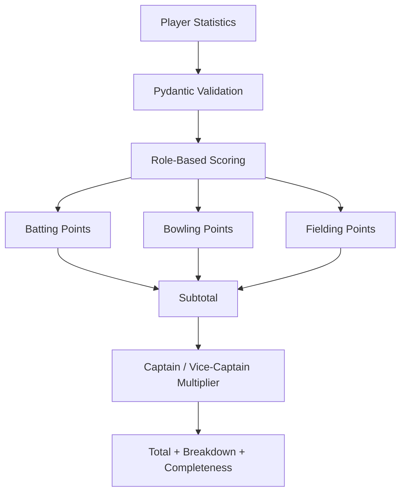
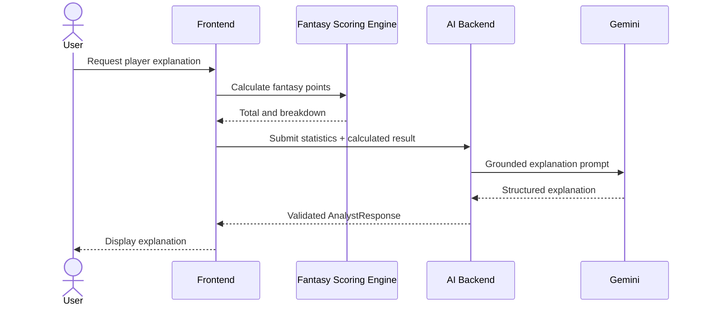

<div align="center">

# 🏏 FantasyEdge AI

### A Fantasy Cricket Analytics & Player Performance Companion

**Understand player performance. Calculate fantasy points transparently. Compare players. Get AI-powered explanations.**

[](https://www.python.org/)
[](https://fastapi.tiangolo.com/)
[](https://react.dev/)
[](https://vite.dev/)
[](https://ai.google.dev/)

[**Live Demo**](https://fantasy-edge-ai-tawny.vercel.app/) · [**GitHub Repository**](https://github.com/Faraz-05/FantasyEdgeAI)

</div>

---

## 📌 Overview

FantasyEdge AI is a full-stack fantasy cricket companion that transforms cricket match and player statistics into **transparent fantasy-point calculations, player comparisons, match insights, and AI-generated explanations**.

Instead of treating fantasy points as just a final number, the application makes the calculation understandable by showing how batting, bowling, fielding, and bonus contributions affect a player's total.

The application combines a React dashboard, a FastAPI backend, Cricket Data API integration, a deterministic fantasy scoring engine, and Google Gemini for grounded natural-language explanations.

> **Product positioning:** FantasyEdge AI is an analytics and explanation companion for fantasy cricket. It does not automatically select a team, predict match outcomes, or claim exact Dream11 scoring equivalence.

---

## 🎯 Problem Statement

Cricket fans and fantasy players encounter a large amount of match and player information—runs, boundaries, strike rates, wickets, economy rates, catches, and other performance statistics.

However, interpreting these statistics in the context of fantasy scoring can require manually connecting multiple pieces of information.

FantasyEdge AI addresses this problem by bringing together:

- **Player statistics:** A structured view of batting, bowling, and fielding contributions.
- **Transparent fantasy scoring:** A deterministic calculation with a category-wise breakdown.
- **Player comparison:** A side-by-side view of two players' statistics and calculated fantasy points.
- **Match context:** Scorecard-derived innings and contribution summaries.
- **AI explanations:** Natural-language interpretation of supplied statistics and calculated results.

### The design goal

Make fantasy cricket statistics **easier to inspect, compare, calculate, and understand**—while keeping the underlying scoring calculation deterministic and explainable.

---

## ✨ Features

### 📊 Match & Player Dashboard
- Browse live and recent cricket matches.
- Switch between Live Cricket Data and Demo Mode.
- Select a match and inspect its available player statistics.
- View batting, bowling, and fielding contributions.
- Access scorecard-derived match momentum summaries.

### 🧮 Fantasy Points Calculator
- Calculate fantasy points using configurable T20-style scoring rules.
- Support Batter, Bowler, All-rounder, and Wicketkeeper roles.
- View batting, bowling, fielding, and bonus breakdowns.
- Apply captain and vice-captain multipliers.
- Identify incomplete calculations and unavailable statistics.
- Distinguish an unknown statistic from a known zero.

### 👥 My Fantasy Team
- Manually select up to 11 players.
- Assign player roles.
- Set captain and vice-captain.
- Calculate individual player points and a team total.
- Persist the manually selected team in browser local storage.

### ⚖️ Player Comparison
- Compare two players from the selected match.
- Inspect batting, bowling, and fielding statistics side by side.
- Compare their calculated fantasy points.
- Request an AI-generated comparison explanation.

### 📈 Match Momentum
- Inspect innings-level summaries.
- View runs, wickets, overs, run rate, and target where available.
- Review batting and bowling contributions.
- Display dismissal events when supplied by the scorecard.
- Preserve unavailable information instead of inventing it.

This is a scorecard-derived match summary, not a ball-by-ball live streaming system.

### 🤖 Gemini AI Analyst
- Explain an individual player's performance.
- Explain differences between two players.
- Interpret the Python-generated fantasy points breakdown.
- Return structured, validated analysis.
- Treat missing statistics as unavailable.
- Avoid recalculating fantasy points or making future-performance guarantees.

### 🔄 Live & Demo Modes
- **Live Mode:** Uses Cricket Data API.
- **Demo Mode:** Uses a saved Durham vs Warwickshire fixture.
- Mode is selected per request and propagated through match-data calls.
- Demo data is clearly labeled and does not consume live provider quota.
- Provider failures are not silently replaced with fixture data.

---

## 🖥️ Application

### Live Application

🔗 **[Open FantasyEdge AI](https://fantasy-edge-ai-tawny.vercel.app/)**

The application uses a Vercel-hosted frontend and a Render-hosted backend.

> The Live Mode depends on Cricket Data API availability and quota. Demo Mode is available for exploring the application with a saved fixture.

### Application Screens

<!-- Replace these placeholders with actual screenshots captured from the application. -->
<!-- Recommended: add images under frontend/public/screenshots/ and link them here. -->

| Dashboard | Fantasy Team |
|:---:|:---:|
| <!--  --> | <!--  --> |
| Match selection, player statistics, and calculations | Manual XI selection and fantasy-point totals |

| Player Comparison | Match Momentum |
|:---:|:---:|
| <!--  --> | <!--  --> |
| Compare player statistics and calculated points | Inspect innings and performance contributions |

---

## 🏗️ System Architecture

FantasyEdge AI separates presentation, data retrieval, deterministic scoring, and AI explanation into distinct responsibilities.



### Architecture principles

- **Separation of concerns:** UI, provider integration, normalization, scoring, and AI explanation have separate responsibilities.
- **Deterministic scoring:** Fantasy points are calculated by Python, not generated by an LLM.
- **Explicit data modes:** Live and Demo services are selected per request.
- **Stable response contracts:** Provider data is normalized before being consumed by the frontend.
- **Safe handling of missing data:** Unknown statistics remain unavailable rather than being assumed to be zero.
- **Backend-only credentials:** Cricket Data and Gemini keys are not exposed in browser assets.

---

## 🔁 How It Works

### 1. Match & Player Data Flow



### 2. Fantasy Points Calculation



### 3. AI Explanation Flow



**Important:** Gemini receives the calculated result as input. It explains the result but does not independently calculate or replace the Python scoring engine.

---

## 🧠 AI Design: Why Gemini Is an Analyst, Not the Scoring Engine

FantasyEdge AI uses Google Gemini to make statistical information easier to understand.

The scoring engine and AI analyst have deliberately different responsibilities:

| Component | Responsibility |
|---|---|
| Python scoring engine | Calculate fantasy points using deterministic rules |
| Cricket normalizer | Convert provider responses into stable application data |
| Gemini analyst | Explain supplied statistics and calculated scoring |
| Pydantic validation | Validate request and structured AI response shapes |
| React frontend | Present statistics, calculations, and explanations |

### AI reliability measures

- The model receives player statistics and Python-generated scoring results.
- Prompts instruct the model to use only the supplied facts.
- The model is instructed not to recalculate fantasy points.
- Missing statistics are represented as unavailable.
- AI responses are validated against a structured response model.
- Demo analysis is labeled as based on a local fixture.

Prompt constraints and response validation reduce the risk of unsupported output; they do not guarantee that an LLM can never hallucinate.

---

## 🧮 Fantasy Scoring Engine

The scoring service is implemented in:

`backend/app/services/fantasy_points.py`

### Supported categories

| Category | Examples |
|---|---|
| Batting | Runs, fours, sixes, milestones, duck, strike-rate adjustments |
| Bowling | Wickets, wicket bonuses, dot balls, maiden overs, wicket hauls, economy adjustments |
| Fielding | Catches, catch bonus, stumpings, run-outs |
| Bonuses | Announced lineup, eligible substitute, captain, vice-captain |

### Scoring behavior

- Rules are deterministic and configurable.
- Points are returned with a detailed breakdown.
- Captain and vice-captain multipliers are applied to the subtotal.
- Incomplete statistics are reported.
- Unknown statistics remain `null`/missing rather than silently becoming zero.
- Strike-rate and economy calculations require sufficient statistical inputs.

> **Scoring disclaimer:** FantasyEdge AI uses configurable T20-style fantasy scoring rules. It does not claim exact equivalence to Dream11's official scoring system. Scoring parity should only be claimed after verifying the relevant official rules and implementing them explicitly.

---

## 🔌 API Reference

All application endpoints are served by FastAPI under `/api`.

### Health

| Method | Endpoint | Purpose |
|---|---|---|
| GET | `/api/health` | Backend health check |

### Match & Cricket Data

| Method | Endpoint | Purpose |
|---|---|---|
| GET | `/api/matches/live` | Live/current match list |
| GET | `/api/matches/recent` | Recent and completed match list |
| GET | `/api/matches/{match_id}/scorecard` | Normalized match scorecard |
| GET | `/api/matches/{match_id}/players` | Player-level match statistics |
| GET | `/api/matches/{match_id}/players/{player_id}/insights` | Player insight data |
| GET | `/api/matches/{match_id}/momentum` | Match momentum summary |

Cricket-data endpoints accept a `mode` query parameter:

```text
?mode=live
?mode=demo
```

### Fantasy Calculation

| Method | Endpoint | Purpose |
|---|---|---|
| POST | `/api/fantasy/calculate` | Calculate fantasy points from player statistics |

### AI Analyst

| Method | Endpoint | Purpose |
|---|---|---|
| POST | `/api/ai/analyze-player` | Generate a player explanation |
| POST | `/api/ai/analyze-comparison` | Generate a comparison explanation |

Interactive API documentation is available when the backend is running:

- Swagger UI: `http://localhost:8000/docs`
- OpenAPI schema: `http://localhost:8000/openapi.json`

---

## 🏏 Cricket Data Integration

FantasyEdge AI integrates with Cricket Data API (formerly CricAPI) through a backend provider service.

Provider implementation:

`backend/app/services/cricket_provider.py`

### External endpoints used

| Cricket Data endpoint | Purpose |
|---|---|
| `/currentMatches` | Current/live match data |
| `/matches` | Recent match data |
| `/match_scorecard` | Match scorecards and player statistics |

The provider response is normalized by:

`backend/app/services/cricket_normalizer.py`

### Provider caching

Successful provider responses are cached in process memory:

| Data | Cache TTL |
|---|---:|
| Current/live matches | 60 seconds |
| Recent matches | 5 minutes |
| Scorecards/player statistics | 2 minutes |

Provider failures are not cached. Cache keys include request information and a one-way API-key digest for isolation; the credential itself is not stored in the cache key.

### Quota behavior

- Explicit provider quota errors are classified separately.
- The frontend can offer Demo Mode when quota exhaustion is confirmed.
- Generic HTTP errors, authentication failures, timeouts, and network errors are not silently treated as quota exhaustion.
- Live-data freshness depends on the provider and its plan.

---

## 🧪 Demo Mode

Demo Mode uses the local fixture:

`backend/app/data/demo/durham_warwickshire_scorecard.json`

It provides a saved Durham vs Warwickshire match through the same normalized response contracts used by the application.

| Live Mode | Demo Mode |
|---|---|
| External Cricket Data API | Local scorecard fixture |
| Provider quota and network dependent | No live provider request |
| Data freshness depends on API | Static fixture data |
| Current match availability varies | Fixture is consistently available |

Demo data is clearly labeled and must not be presented as current live cricket.

---

## 🛠️ Tech Stack

### Frontend

| Technology | Purpose |
|---|---|
| React | UI and component rendering |
| Vite | Development server and production build |
| JavaScript | Frontend logic |
| Tailwind CSS | Styling |
| Axios | Backend HTTP requests |
| Recharts | Data visualization |
| Lucide React | Icons |

### Backend

| Technology | Purpose |
|---|---|
| Python | Backend language and scoring logic |
| FastAPI | REST API |
| Pydantic | Request/response validation |
| HTTPX | Asynchronous provider requests |
| Google GenAI SDK | Gemini integration |
| Uvicorn | ASGI server |
| Pytest | Backend testing |

### External Services & Hosting

- Cricket Data API — cricket match and scorecard data.
- Google Gemini — AI-generated explanations.
- Vercel — frontend hosting.
- Render — backend hosting.
- GitHub — source control.

---

## 📁 Project Structure

```text
FantasyEdgeAI/
├── README.md
├── pytest.ini
│
├── backend/
│   ├── requirements.txt
│   ├── .env.example
│   ├── app/
│   │   ├── config.py
│   │   ├── main.py
│   │   ├── routers/
│   │   │   ├── ai.py
│   │   │   └── matches.py
│   │   ├── services/
│   │   │   ├── cricket_demo.py
│   │   │   ├── cricket_normalizer.py
│   │   │   ├── cricket_provider.py
│   │   │   ├── cricket_utils.py
│   │   │   ├── fantasy_points.py
│   │   │   ├── gemini_service.py
│   │   │   ├── historical_repository.py
│   │   │   └── player_insights.py
│   │   └── data/
│   │       └── demo/
│   │           ├── durham_warwickshire_scorecard.json
│   │           └── historical_matches.json
│   └── tests/
│       ├── test_ai.py
│       ├── test_cricket_normalizer.py
│       ├── test_demo_mode.py
│       ├── test_fantasy_points.py
│       ├── test_historical_repository.py
│       ├── test_player_insights.py
│       └── test_scorecard_players.py
│
└── frontend/
    ├── package.json
    ├── vite.config.js
    ├── index.html
    ├── src/
    │   ├── App.jsx
    │   ├── comparison.js
    │   ├── presentation.js
    │   ├── teamBuilder.js
    │   ├── main.jsx
    │   ├── index.css
    │   └── components/
    │       └── ui.jsx
    └── tests/
        ├── comparison.test.js
        ├── comparison-render.test.js
        ├── data-mode.test.js
        ├── momentum-render.test.js
        ├── overview-render.test.js
        ├── presentation.test.js
        ├── shell.test.js
        ├── team-render.test.js
        └── teamBuilder.test.js
```

---

## 🚀 Getting Started

### Prerequisites

- Python 3.13+
- Node.js and npm
- Git
- Cricket Data API key for Live Mode
- Gemini API key for AI explanations (optional)

### 1. Clone the repository

```powershell
git clone https://github.com/Faraz-05/FantasyEdgeAI.git
cd FantasyEdgeAI
```

### 2. Set up the backend

```powershell
py -m venv .venv
.\.venv\Scripts\Activate.ps1

python -m pip install -r backend\requirements.txt

Copy-Item backend\.env.example backend\.env
```

Configure `backend\.env` with the required credentials and settings.

Start the backend:

```powershell
python -m uvicorn backend.app.main:app --reload --port 8000
```

Verify:

```powershell
curl.exe http://localhost:8000/api/health
```

Expected response:

```json
{"status":"ok","message":"FantasyEdge AI backend is ready"}
```

### 3. Set up the frontend

Open a **second PowerShell terminal**:

```powershell
cd frontend
npm install
npm run dev
```

Open:

**http://localhost:5173**

Vite proxies `/api` requests to the local FastAPI backend at `http://localhost:8000`.

### 4. Run tests

From the repository root:

```powershell
.\.venv\Scripts\python.exe -m pytest backend\tests -q
```

From the `frontend` directory:

```powershell
npm test
npm run build
```

The production frontend output is generated in `frontend/dist`.

---

## ⚙️ Environment Configuration

### Backend variables

Configure these in `backend/.env` locally or in the Render backend environment settings:

| Variable | Purpose |
|---|---|
| `FRONTEND_ORIGINS` | Comma-separated explicit browser origins |
| `CRICKET_DATA_API_KEY` | Cricket Data API credential |
| `CRICKET_DATA_API_BASE_URL` | Cricket Data API base URL |
| `DEMO_MODE` | Default data mode when request omits `mode` |
| `GEMINI_API_KEY` | Google Gemini API credential |
| `GEMINI_MODEL` | Gemini model selection |

Example configuration:

```env
FRONTEND_ORIGINS=http://localhost:5173
CRICKET_DATA_API_KEY=your-cricket-data-key
CRICKET_DATA_API_BASE_URL=https://api.cricapi.com/v1
DEMO_MODE=false
GEMINI_API_KEY=your-gemini-key
GEMINI_MODEL=gemini-2.0-flash
```

### Frontend variable

Configure this in `frontend/.env.local` for local overrides or in Vercel:

```env
VITE_API_BASE_URL=https://your-api.onrender.com/api
```

For local development, the Vite proxy is used by default.

> **Security:** Never place Cricket Data or Gemini API keys in `VITE_*` variables. Vite embeds frontend environment variables into browser assets. Keep all provider credentials backend-only.

---

## ☁️ Deployment

The application is designed for separate frontend and backend deployments.

### Frontend — Vercel

- Root directory: `frontend`
- Build command: `npm run build`
- Output directory: `dist`
- Environment variable: `VITE_API_BASE_URL=https://your-render-service.onrender.com/api`

### Backend — Render

- Build command:

  ```bash
  python -m pip install -r backend/requirements.txt
  ```

- Start command:

  ```bash
  python -m uvicorn backend.app.main:app --host 0.0.0.0 --port $PORT
  ```

- Runtime: Python 3.13.6
- Configure `FRONTEND_ORIGINS` with the exact deployed Vercel origin.
- Configure provider and Gemini credentials in Render's environment settings.

CORS uses explicit origins and does not allow wildcard origins with credentials enabled.

---

## 🧪 Testing & Quality

The repository includes automated tests for:

### Backend
- Fantasy scoring rules and edge cases.
- AI request/response behavior.
- Cricket data normalization.
- Provider errors, caching, and quota classification.
- Live/Demo service isolation.
- Player insight construction.
- Historical repository behavior.
- Scorecard player aggregation.

### Frontend
- Application shell and navigation.
- Comparison helpers and rendering.
- Data mode behavior.
- Match momentum rendering.
- Overview rendering.
- Team builder behavior.
- Presentation utilities.

**Previously verified results:**

| Test/Build | Result |
|---|---:|
| Backend tests | 110 passed |
| Frontend tests | 27 passed |
| Vite production build | Passed |

These results reflect a previously completed test run and should be rerun against the current commit before using them as a release guarantee.

---

## 🔐 Security & Reliability

- Provider and Gemini credentials are stored on the backend.
- API keys are not returned to frontend responses.
- Explicit CORS origins are required.
- Provider errors are handled separately from quota exhaustion.
- Successful provider responses are cached.
- Missing statistics remain unknown.
- AI responses are validated against a structured schema.
- Demo mode is explicit and labeled.
- No silent switch from live data to demo data occurs for arbitrary provider failures.

---

## ⚠️ Limitations & Future Work

FantasyEdge AI is an evolving project. The current implementation focuses on match statistics, deterministic scoring, player comparison, and AI explanations.

### Current limitations

- No user authentication or account system.
- Manual teams are stored in browser local storage.
- No server-side saved teams or user history.
- No automated optimal team selection.
- No prediction or future-performance guarantee.
- No ball-by-ball live streaming interface.
- Match momentum is scorecard-derived.
- Live data depends on provider availability and quota.
- No browser-level end-to-end test suite.
- No formal monitoring/observability platform.

### Planned improvements

- Historical player performance trends.
- Venue and opponent-specific statistics.
- Ball-by-ball match momentum.
- Partnership and fall-of-wickets analysis.
- Confirmed lineup and player availability context.
- Data freshness indicators.
- Browser end-to-end testing.
- Provider contract tests and deployment smoke tests.
- Persistent teams and user accounts.
- Opt-in scenario analysis and team optimization.
- Structured logging, metrics, and rate limiting.

---

## 💡 What I Learned

This project brought together several important engineering concepts:

- Designing a frontend/backend application with explicit API contracts.
- Separating external provider integration from data normalization.
- Implementing deterministic business logic independently of an LLM.
- Handling unknown, missing, and zero-valued statistics correctly.
- Building request-scoped Live/Demo behavior without global mode mutation.
- Validating structured AI output and designing grounded prompts.
- Testing provider errors, scoring edge cases, and application behavior.
- Deploying a React frontend and Python API as separate services.

---

## 👨‍💻 Author

**Faraz Kazi**

AI & Data Science Engineering · Full-Stack AI/ML Projects

- GitHub: [@Faraz-05](https://github.com/Faraz-05)
- LinkedIn: [farazkazi](https://www.linkedin.com/in/farazkazi/)

---

<div align="center">

### FantasyEdge AI
**Making fantasy cricket statistics more transparent and understandable.**

⭐ If you find this project interesting, consider giving the repository a star.

</div>
